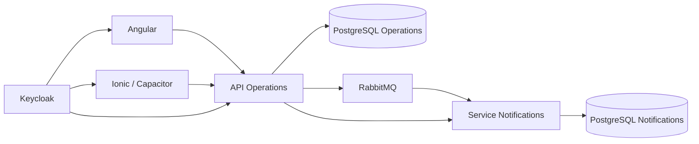

# Décisions d’architecture

## 1. Modules métier puis extraction des notifications

Le backend garde les commandes d’intervention dans un processus Spring MVC. Le relais outbox parle à un consommateur déployable séparément. Les notifications ont leurs propres bases par variante et un compte PostgreSQL distinct du backend d’opérations.

Une notification en retard laisse l’affectation utilisable. En contrepartie, l’utilisateur voit la notification après le traitement asynchrone. Le test `events.py` interrompt le broker et mesure ce comportement.

## 2. Spring MVC et JPA

Le domaine conserve ses règles dans `Request` en Java et `Intervention` en Kotlin. Les adaptateurs mappent les demandes vers des lignes JPA. Flyway versionne le schéma, et Hibernate le valide au démarrage. La requête de lecture applique le filtre d’accès avant pagination.

Le backend accepte une commande à la version lue par le client. La comparaison métier donne une erreur explicite quand la version a changé. Le verrouillage optimiste de Hibernate couvre le cas où deux transactions ont lu simultanément la même version. Un test lance deux appels avec une barrière et exige un succès et un conflit.

## 3. Contrat commun et implémentations indépendantes

Les clients partagent les types et l’accès HTTP. Les variantes JVM partagent les fichiers de schéma et la suite d’acceptation, et ont chacune leur code métier, leur mapping et leurs propres données locales. La parité se constate sur les statuts, les règles, la validation et la reprise. Les identifiants générés et les dates peuvent varier d’une exécution à l’autre.

## 4. OIDC avec PKCE et autorisation par objet

Les clients utilisent un code d’autorisation avec PKCE. L’API vérifie la signature, l’issuer et l’audience du jeton d’accès. Le sujet OIDC identifie l’acteur. Les rôles influencent les actions disponibles et le propriétaire ou le technicien affecté détermine la visibilité de chaque demande. Les demandes masquées répondent `404`.

Le navigateur stocke la session dans `sessionStorage`. Sur le natif, l’application garde les jetons en mémoire et conserve les brouillons dans Preferences, par compte et par variante. La déconnexion retire le compte courant de l’accès hors ligne. Les données de ce laboratoire sont fictives. Le profil `demo` et le client de test Keycloak à mot de passe servent aux tests locaux.

## 5. Outbox, confirmations et déduplication

L’affectation et la ligne outbox sont enregistrées dans la même transaction. Le relais réserve une ligne avec `FOR UPDATE SKIP LOCKED` et attend la confirmation RabbitMQ. Un échec laisse la ligne en attente avec une reprise bornée à dix tentatives. Un doublon après la confirmation est possible si le relais redémarre avant d’enregistrer la publication.

Le consommateur valide le message et insère la notification dans sa propre transaction. La clé unique de l’événement et celle de l’affectation rendent l’opération idempotente. Le broker acquitte le message après le retour du listener. Une livraison invalide ou qui a épuisé ses reprises rejoint la file de diagnostic. [Confirms RabbitMQ](https://www.rabbitmq.com/docs/confirms)

### Identité et provisionnement

`SUPER_ADMIN` permet de consulter l’annuaire, de créer des comptes responsables et techniciens et de lire toutes les interventions. L’API extrait le rôle du JWT et contrôle séparément les commandes qui modifient les interventions. L’inscription publique passe par le formulaire Keycloak et reçoit `REQUESTER` via le rôle par défaut du realm.

L’adaptateur partagé par Java et Kotlin utilise un compte de service Keycloak. Un compte d’équipe reste désactivé jusqu’à l’application de son rôle, puis doit changer son mot de passe temporaire à la première connexion. L’annuaire de Keycloak est consulté lors de la sélection et de l’affectation du technicien.
